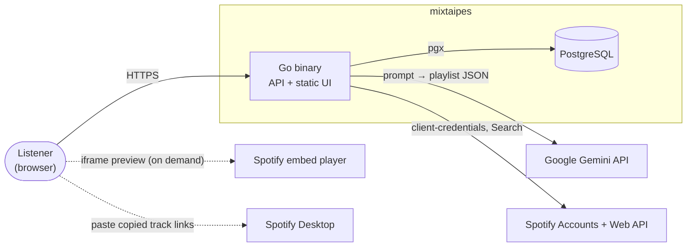
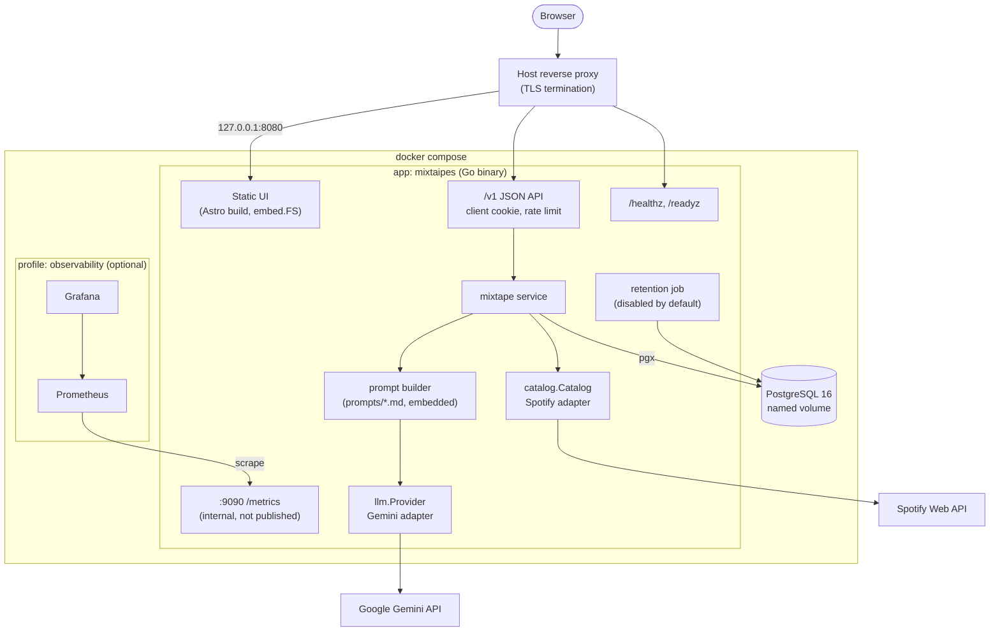
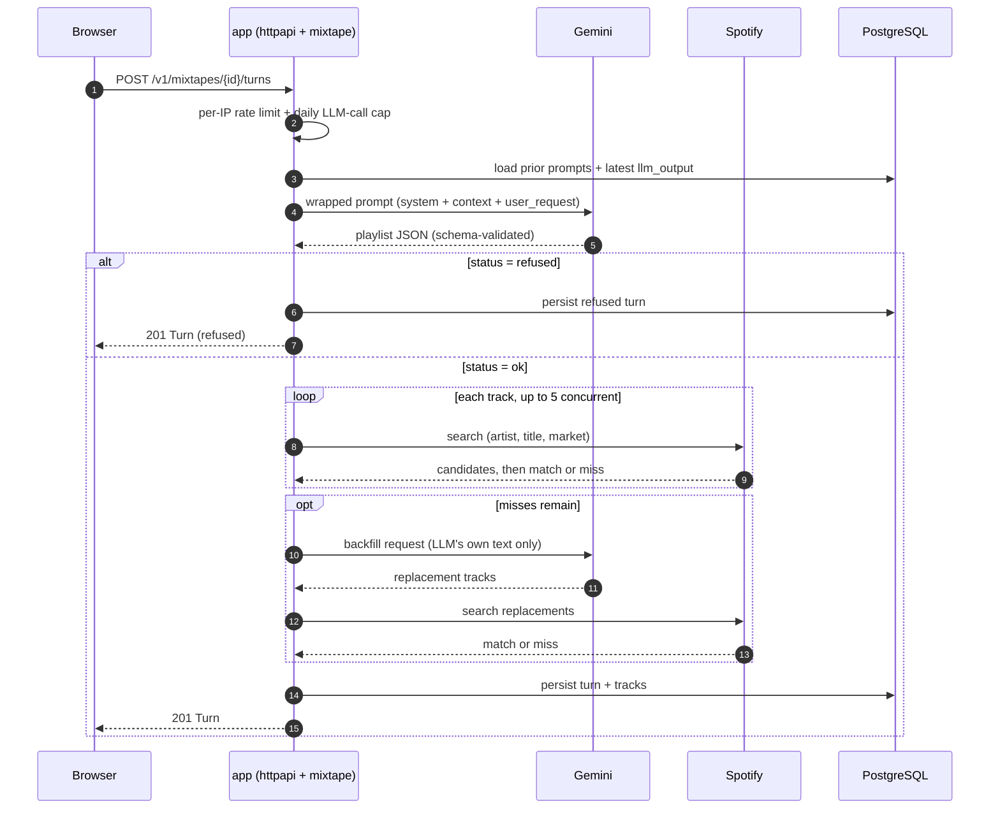

# Architecture — mixtaipes

> C4 Level 1 (System Context) and Level 2 (Containers), plus the core request flow.
> Status: v1 (M0) — Last updated: 2026-10-10

## Principles

- **Keep it simple.** One binary, one database, one compose file. New infrastructure needs an ADR with a measured trigger.
- **The LLM proposes, the catalog decides.** Nothing reaches the user as a playable track unless Spotify Search confirmed it.
- **Spotify content never flows into the LLM** (ADR-007).
- **Stateless server process.** All durable state lives in PostgreSQL; in-memory state (rate-limit buckets, Spotify app token) is safe to lose on restart.

## Level 1 — System Context

| Actor / system | Interaction |
|----------------|-------------|
| Listener | Anonymous browser user; writes prompts, refines, previews, copies, shares |
| Google Gemini API | Generates playlist JSON from the wrapped prompt (structured output) |
| Spotify Accounts | Issues the app access token (client-credentials) |
| Spotify Web API | `GET /v1/search` to verify each proposed track |
| Spotify embed player | Loaded directly by the browser (`open.spotify.com/embed/track/{id}`); the server is not involved |
| Spotify Desktop | Destination of the copied track links; outside the system |

## Level 2 — Containers

| Container | Technology | Responsibility |
|-----------|------------|----------------|
| `app` | Go binary, distroless image | Serves the static UI and the `/v1` API, runs migrations at startup, orchestrates LLM + catalog, exposes metrics on an internal port |
| `db` | PostgreSQL 16 | Mixtapes, turns, tracks, shares, events |
| `prometheus` *(optional)* | Prometheus | Scrapes `app:9090/metrics` |
| `grafana` *(optional)* | Grafana | Dashboards over Prometheus |

The reverse proxy is not part of the compose file: any TLS-terminating proxy that forwards to `127.0.0.1:8080` and sets `X-Forwarded-For` works.

## Code layout (inside `app`)

| Package | Responsibility |
|---------|----------------|
| `cmd/mixtaipes` | Server entrypoint and wiring |
| `cmd/eval` | Prompt evaluation runner (ADR-005) |
| `internal/config` | Environment-based configuration |
| `internal/httpapi` | Handlers, middleware (client cookie, rate limit, request logging), static file serving |
| `internal/mixtape` | Domain service: generate, refine, backfill, share |
| `internal/llm` | `Provider` interface, Gemini adapter, output schema + validation |
| `internal/catalog` | `Catalog` interface, Spotify adapter (token, search, matching) |
| `internal/store` | Hand-written SQL over `pgx/v5` (`pgxpool`), row mapping with `pgx.CollectRows`, transactions |
| `internal/metrics` | Prometheus collectors |
| `prompts` | Versioned system prompts (embedded) and the request builder; never imports `catalog` (ADR-007) |

## Core flow — one turn (generate or refine)

## Cross-cutting concerns

| Concern | Approach | ADR |
|---------|----------|-----|
| Prompt safety | Versioned system prompt, delimited user input, typed refusals, schema validation | 004 |
| Prompt quality | Evaluation harness with tracked metrics per prompt version | 005 |
| Spotify policy | LLM receives only its own previous output and a not-found flag | 007 |
| Abuse / quota | Per-IP token bucket + global daily LLM-call cap | 010 |
| Privacy | Anonymous cookie, hashed client id, privacy notice on the LLM provider's data terms | 010, 014 |
| Observability | Prometheus metrics on an internal port | 013 |
| Localization | Astro i18n routes (`/`, `/es/`), locale passed to the LLM | 012 |

## Configuration (environment)

| Variable | Default | Purpose |
|----------|---------|---------|
| `DATABASE_URL` | — | PostgreSQL DSN |
| `PUBLIC_BASE_URL` | — | Absolute base URL for share links |
| `HTTP_ADDR` / `METRICS_ADDR` | `:8080` / `:9090` | Listeners |
| `GEMINI_API_KEY` / `GEMINI_MODEL` | — / Flash-class model | LLM provider |
| `GEMINI_FALLBACK_MODEL` | — (retry on the same model) | Model used for the single retry after an overload error (ADR-003) |
| `PROMPT_VERSION` | latest file in `prompts/` | Active system prompt |
| `SPOTIFY_CLIENT_ID` / `SPOTIFY_CLIENT_SECRET` | — | Client-credentials flow |
| `SPOTIFY_MARKET` | `US` | Fallback ISO 3166-1 alpha-2 market when `Accept-Language` has no usable region |
| `RATE_LIMIT_PER_IP` | `10/h` | Turns per client IP |
| `DAILY_LLM_CALL_CAP` | `400` | Global LLM calls per UTC day |
| `TRUSTED_PROXIES` | loopback + private ranges | Sources allowed to set `X-Forwarded-For` (a host proxy reaches the container through the Docker bridge, not loopback) |
| `RETENTION_DAYS` | `0` (disabled) | Retention job threshold |
