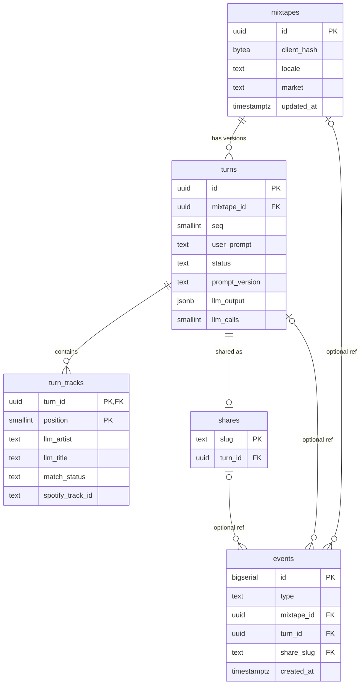

# Database Schema — mixtaipes

> Source of truth for tables/columns. Migrations only additive during MVP.
> Status: v1 (M0) — Last updated: 2026-10-10

## Conventions

- Naming: snake_case, plural tables, singular FK columns (`mixtape_id`).
- Keys: UUID v7 generated in Go (`uuid` type); `events` uses `bigserial`; `shares` uses its slug.
- Timestamps: every table gets `created_at`, `updated_at` (`timestamptz`, default `now()`); `events` is append-only and has `created_at` only.
- Enumerations: `text` + `CHECK` constraints (easier to extend than PostgreSQL enums).
- Migrations tool: `golang-migrate` — sequential pairs `migrations/NNNNNN_name.up.sql` / `NNNNNN_name.down.sql`, embedded via the `iofs` source, applied at startup with the `pgx/v5` driver; state in `schema_migrations`.
- Queries: hand-written SQL with `pgx/v5` in `internal/store`; no ORM, no code generation.
- Spotify data stored: only track id and minimal display data (name, artists, album image URL). Never fed to the LLM (ADR-007).

## Tables

### mixtapes

| Column | Type | Constraints | Notes |
|--------|------|-------------|-------|
| id | uuid | PK | v7 |
| client_hash | bytea | NOT NULL | `sha256(mx_client cookie)` |
| locale | text | NOT NULL, CHECK in (`en`,`es`) | Language for UI and LLM text |
| market | text | NOT NULL, CHECK length = 2 | `Accept-Language` region if it is a Spotify market, else `SPOTIFY_MARKET`; fixed at creation (ADR-006) |
| created_at | timestamptz | NOT NULL DEFAULT now() | |
| updated_at | timestamptz | NOT NULL DEFAULT now() | Bumped on each turn; used by retention |

Indexes: `(client_hash, updated_at DESC)`.

### turns

| Column | Type | Constraints | Notes |
|--------|------|-------------|-------|
| id | uuid | PK | v7 |
| mixtape_id | uuid | NOT NULL, FK → mixtapes ON DELETE CASCADE | |
| seq | smallint | NOT NULL, UNIQUE (mixtape_id, seq), CHECK 1–20 | Version number |
| user_prompt | text | NOT NULL, CHECK length ≤ 500 | Raw user text |
| status | text | NOT NULL, CHECK in (`ok`,`refused`,`failed`) | |
| refusal_reason | text | NULL, CHECK in (`off_topic`,`unsafe`,`unclear`) | |
| error_code | text | NULL | API error code when `failed` |
| prompt_version | text | NOT NULL | e.g. `v3` |
| llm_model | text | NOT NULL | Provider model id |
| llm_output | jsonb | NULL | Validated LLM output, verbatim; the **only** source of LLM context (ADR-007) |
| llm_calls | smallint | NOT NULL DEFAULT 0 | 1 or 2 (backfill); daily-cap accounting |
| input_tokens | integer | NOT NULL DEFAULT 0 | Summed across calls |
| output_tokens | integer | NOT NULL DEFAULT 0 | |
| llm_latency_ms | integer | NOT NULL DEFAULT 0 | |
| catalog_latency_ms | integer | NOT NULL DEFAULT 0 | |
| created_at | timestamptz | NOT NULL DEFAULT now() | |
| updated_at | timestamptz | NOT NULL DEFAULT now() | |

Indexes: `(created_at)` for the daily-cap sum.

### turn_tracks

| Column | Type | Constraints | Notes |
|--------|------|-------------|-------|
| turn_id | uuid | PK part, FK → turns ON DELETE CASCADE | |
| position | smallint | PK part, CHECK 1–30 | Display order |
| llm_artist | text | NOT NULL | As written by the LLM |
| llm_title | text | NOT NULL | As written by the LLM |
| why | text | NOT NULL | As written by the LLM |
| match_status | text | NOT NULL, CHECK in (`matched`,`not_found`) | |
| backfilled | boolean | NOT NULL DEFAULT false | Came from the backfill call |
| spotify_track_id | text | NULL | Set when matched |
| spotify_name | text | NULL | Display only |
| spotify_artists | text[] | NULL | Display only |
| album_image_url | text | NULL | Display only |
| created_at | timestamptz | NOT NULL DEFAULT now() | |
| updated_at | timestamptz | NOT NULL DEFAULT now() | |

### shares

| Column | Type | Constraints | Notes |
|--------|------|-------------|-------|
| slug | text | PK, CHECK length = 10 | base62, random |
| turn_id | uuid | NOT NULL, UNIQUE, FK → turns ON DELETE CASCADE | One share per version |
| created_at | timestamptz | NOT NULL DEFAULT now() | |
| updated_at | timestamptz | NOT NULL DEFAULT now() | |

### events

| Column | Type | Constraints | Notes |
|--------|------|-------------|-------|
| id | bigserial | PK | |
| type | text | NOT NULL, CHECK in (`copy`,`preview_play`,`share_created`,`share_view`) | |
| mixtape_id | uuid | NULL, FK → mixtapes ON DELETE SET NULL | |
| turn_id | uuid | NULL, FK → turns ON DELETE SET NULL | |
| share_slug | text | NULL, FK → shares ON DELETE SET NULL | |
| created_at | timestamptz | NOT NULL DEFAULT now() | |

Indexes: `(type, created_at)` for weekly North Star queries.



## Key queries

```sql
-- Daily LLM-call cap (ADR-010)
SELECT COALESCE(SUM(llm_calls), 0) FROM turns
WHERE created_at >= date_trunc('day', now() AT TIME ZONE 'UTC') AT TIME ZONE 'UTC';

-- North Star: copies per ISO week
SELECT date_trunc('week', created_at) AS week, count(*) FROM events
WHERE type = 'copy' GROUP BY 1 ORDER BY 1;
```

## Migrations policy (MVP)

- Additive only (new columns = NULL or DEFAULT).
- Never drop columns/indexes in MVP.
- Every schema change lands with its migration file in the same commit.
- Migrations run at startup; `golang-migrate` holds a PostgreSQL advisory lock while migrating.
- A failed migration leaves the version `dirty` and the app refuses to start: fix the SQL, then `migrate force <version>` manually.
- Every `.up.sql` has a `.down.sql`; down migrations are for local development only and are never run in production.
